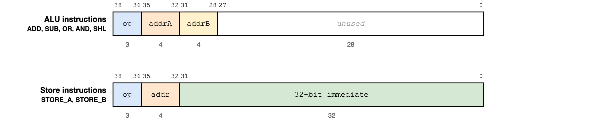
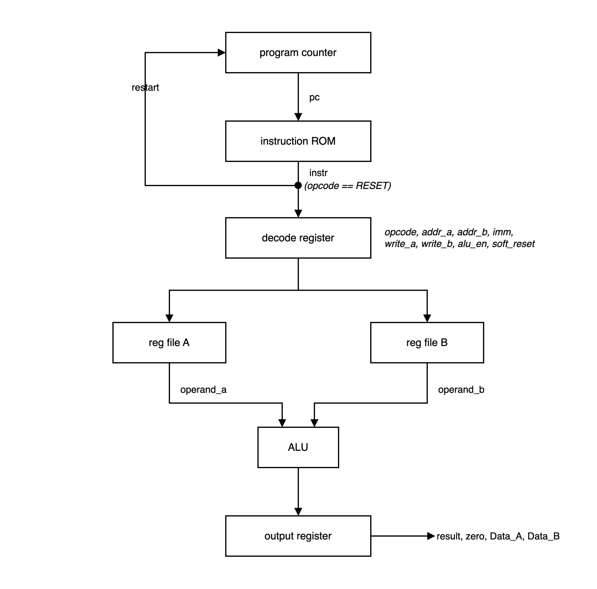
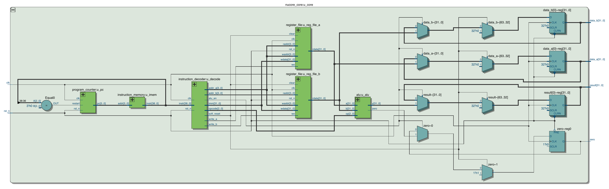

# NuCore

NuCore is a small pipelined 32-bit soft-core processor written in Verilog-2001
for the Terasic DE1-SoC (Intel Cyclone V 5CSEMA5F31C6). It executes a fixed
program from instruction memory, keeps its operands in two 16-entry register
files, and shows the operands and the ALU result on the board's seven-segment
displays.

The instruction set and the original design report (RTL view, Quartus
waveform simulation and board photos) are in `Instruction_set_simulation.pdf`.

## Layout

| Path                      | Contents                                                        |
| ------------------------- | --------------------------------------------------------------- |
| `rtl/NuCore.v`            | Board top level: KEY/HEX/LEDR mapping and seven-segment drivers  |
| `rtl/nucore_core.v`       | The processor: fetch, decode and execute stages                 |
| `rtl/program_counter.v`   | Program counter with synchronous restart                        |
| `rtl/instruction_memory.v`| 64 x 39-bit instruction ROM loaded with `$readmemb`             |
| `rtl/instruction_decoder.v`| Pipeline register holding the decoded instruction              |
| `rtl/register_file.v`     | 16 x 32-bit register file, one write port, one read port        |
| `rtl/alu.v`               | Combinational ALU                                               |
| `rtl/seg_7.v`             | Hex digit to active-low seven-segment decoder                   |
| `rtl/nucore_opcodes.vh`   | Instruction field widths and opcode constants                   |
| `tb/NuCore_TB.v`          | Self-checking testbench with a reference model of the ISA       |
| `memory.dat`              | Default program (loaded by both Quartus and the testbench)      |
| `programs/`               | Alternative programs in the same format                         |
| `sim/Waveform.vwf`        | Quartus vector waveform file from the original project          |
| `NuCore.qpf`, `NuCore.qsf`| Quartus Prime project and settings (pin assignments included)   |
| `Makefile`                | Optional Verilator lint and Yosys synthesis-check targets       |
| `docs/*.drawio`           | Editable draw.io sources of the diagrams in this README          |
| `docs/images/`            | Exported diagrams and the Quartus RTL view used below            |
| `docs/RTL.pdf`            | Quartus RTL Viewer export of the synthesised core                |

## Instruction set

Every instruction is 39 bits, written as one binary line in the program file,
most significant bit first. The top three bits are the opcode. ALU
instructions carry two 4-bit register-file addresses and leave the low 28
bits unused; store instructions carry one 4-bit address and a 32-bit
immediate. In the diagram the bit numbers are shown above the fields and the
field widths in bits below.

| Field     | Bits    | Width | Present in                 |
| --------- | ------- | ----- | -------------------------- |
| `op`      | 38..36  | 3     | all instructions           |
| `addrA`   | 35..32  | 4     | ALU instructions           |
| `addrB`   | 31..28  | 4     | ALU instructions           |
| `addr`    | 35..32  | 4     | STORE_A, STORE_B           |
| immediate | 31..0   | 32    | STORE_A, STORE_B           |

| Opcode | Mnemonic | Format           | Effect                                          |
| ------ | -------- | ---------------- | ----------------------------------------------- |
| `000`  | RESET    | -                | Clear both register files and the output registers, restart the program |
| `001`  | STORE_A  | addr, immediate  | `A[addr] <= immediate`                          |
| `010`  | STORE_B  | addr, immediate  | `B[addr] <= immediate`                          |
| `011`  | ADD      | addrA, addrB     | `result <= A[addrA] + B[addrB]`                 |
| `100`  | SUB      | addrA, addrB     | `result <= A[addrA] - B[addrB]`                 |
| `101`  | OR       | addrA, addrB     | `result <= A[addrA] | B[addrB]`                 |
| `110`  | AND      | addrA, addrB     | `result <= A[addrA] & B[addrB]`                 |
| `111`  | SHL      | addrA, addrB     | `result <= A[addrA] << B[addrB]`                |

### Encoding examples

Taken from `memory.dat`, split as opcode, address, remainder:

| Instruction          | Encoding |
| -------------------- | -------- |
| `STORE_A 1, 2`       | `001` `0001` `00000000000000000000000000000010` |
| `STORE_B 1, 9`       | `010` `0001` `00000000000000000000000000001001` |
| `ADD A[1], B[1]`     | `011` `0001` `00010000000000000000000000000000` |
| `AND A[1], B[1]`     | `110` `0001` `00010000000000000000000000000000` |
| `RESET`              | `000` `0000` `00000000000000000000000000000000` |

For the ALU rows the third group is `addrB` followed by 28 unused zero bits;
for the store rows it is the 32-bit immediate.

Every ALU instruction also latches its operands into `Data_A` and `Data_B`
and sets the zero flag when the result is zero. Store and RESET instructions
leave `result`, `Data_A` and `Data_B` unchanged (RESET clears them).

## Micro-architecture

- **Fetch.** The program counter addresses the instruction ROM. When the
  fetched opcode is RESET the counter restarts at zero on the next clock, so a
  program loops forever once it reaches its RESET instruction. Instruction
  memory not covered by the program file reads as RESET.
- **Decode.** The instruction fields and the control strobes derived from the
  opcode are registered together, so the execute stage always sees a
  consistent instruction.
- **Execute.** Stores write the immediate into the addressed register file
  entry. ALU instructions read both register files, compute the result and
  register `result`, `zero`, `Data_A` and `Data_B`. RESET clears all of them.

An instruction fetched on clock edge N takes effect after edge N+2. Because the
register files are written at the end of the execute stage and read
combinationally at the start of it, an ALU instruction immediately following a
store already sees the stored value, so there are no hazards to manage.

All state has an asynchronous active-low reset from `KEY[1]`.

### RTL view

The same structure as synthesised by Quartus Prime, from the RTL Viewer
(`docs/RTL.pdf`). The comparator on the left detects the RESET opcode on the
fetched instruction and drives the program counter's restart input; the
multiplexers and registers on the right are the output register with its
clear and hold paths.

## Board interface

| Signal    | Function                                              |
| --------- | ----------------------------------------------------- |
| `KEY[0]`  | Clock. Each press and release executes one instruction |
| `KEY[1]`  | Reset, active low (hold the button to reset)          |
| `HEX1:0`  | Low byte of `Data_A`                                  |
| `HEX3:2`  | Low byte of `Data_B`                                  |
| `HEX5:4`  | Low byte of `result`                                  |
| `LEDR[0]` | Zero flag                                             |

The 32-bit `result`, `Data_A` and `Data_B` ports exist so the testbench can
observe the full values. They are declared as virtual pins in `NuCore.qsf` so
the fitter does not route them to physical pins.

## Simulation

The self-checking testbench `tb/NuCore_TB.v` runs under ModelSim-Altera, the
simulator bundled with Quartus Prime Lite, launched from Quartus.

Open `NuCore.qpf` and run *Tools > Run Simulation Tool > RTL Simulation*.
The project is already set up for NativeLink: the simulation tool is
ModelSim-Altera (Verilog) and the test bench `NuCore_TB` (file
`tb/NuCore_TB.v`) is registered under *Assignments > Settings > EDA Tool
Settings > Simulation*. Quartus compiles the RTL and the testbench, starts
ModelSim in `simulation/modelsim` and runs until the testbench stops. The
transcript ends with `TEST PASSED` or `TEST FAILED`, and the waveform stays
open for inspection.

The testbench reads `memory.dat` through `../../memory.dat` when compiled by
ModelSim, which is where the project root lies relative to
`simulation/modelsim`. If you move the simulation directory, compile with
`+define+PROGRAM_FILE="<path>"` instead.

### What the testbench checks

The testbench drives `KEY[0]` as a 10 ns clock (as in the design report) and
`KEY[1]` as the reset. It loads the program into its own reference model of
the instruction set and compares `result`, the zero flag, `Data_A`, `Data_B`
and all six HEX displays against it after every instruction. It runs the
program twice (which crosses the RESET restart), then asserts the
asynchronous reset in the middle of the program and runs it again. It prints
`TEST PASSED` or `TEST FAILED`.

With `memory.dat`, which stores 1..10 into `A[0..9]` and 10..1 into
`B[0..9]` (entries 10 and 11 are stored as 0) before adding and AND-ing
`A[i]` with `B[i]` for `i` = 0..11, every ADD of the first ten pairs produces
11 and the last two produce 0.

## Building for the DE1-SoC

Open `NuCore.qpf` in Quartus Prime, compile, and program the generated `.sof`.
The project lists the files under `rtl/` and uses `rtl` as its search path for
the opcode header. The program file is read from the project directory, so
keep `memory.dat` next to `NuCore.qpf` or change the `PROGRAM_FILE` parameter
of the top level.

Simulation from Quartus (NativeLink) uses `tb/NuCore_TB.v`; see
[Simulation](#simulation).

## Program files

One instruction per line, 39 binary digits, most significant bit first.
Lines are loaded from address 0 upwards. End the program with a RESET
instruction (`000...0`) to make it loop; this is also what the testbench uses
to find the program length.
